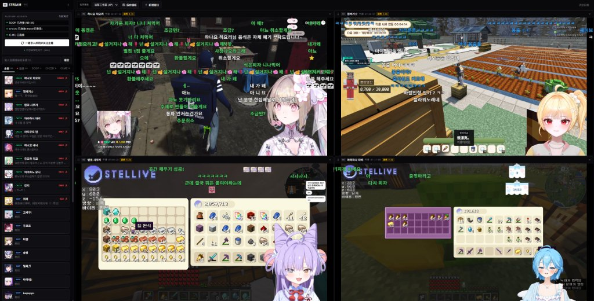

# KRStream

SOOP、Chzzk、CI.ME 独立多屏直播播放器（Chromium MV3 扩展）。



---

## 功能模块

### 播放与流调度
- 平台解析：SOOP（最高 1440p / 1080p60）、Chzzk（LL-HLS）、CI.ME（IVS），支持直连 M3U8 地址
- CDN 节点：各窗口独立切换与记忆节点
- 延迟控制：2.0x 追帧、自定义目标延迟下限、SOOP Catch / Chzzk 时光机回看
- 音频控制：0-200% 音量增益，支持滚轮调节
- 媒体输出：本地 MP4 录制、截图、画中画（含弹幕与字幕）、右键调试面板

### 窗口与工作区
- 网格布局：多窗口动态网格、拖拽换位
- 布局模板：保存、切换与删除多屏主播组合配置
- 偏好设置：配置进入直播间默认开启项（SC / 弹幕 / 字幕）、默认双语语言、默认画质及各平台首选 CDN 路线

### 弹幕与字幕
- 滚动弹幕：不透明度、字号、速度、区域可调；支持 SOOP 房间自定义表情 / OGQ 贴纸
- 会员区分：SOOP 与 Chzzk 会员弹幕独立配色与自定义取色
- 实时字幕：8 种语言主副双语配对，字号 / 透明度 / 颜色 / 对齐可调
- 历史字幕：按窗口缓存、关键词检索、点击跳转回放、导出台词长图（PNG）
- SC 与订阅：左上角分区展示订阅（固定 5s）与可滚动打赏列表（按金额分级停留 10s-120s），支持独立开关与打赏记录面板

### 账号与关注
- 登录态读取：复用浏览器本地 Cookie，自动识别各平台账号用户名
- 关注列表：一键同步并轮询开播状态，支持置顶、平台筛选与直链复制

---

## 安装

### 发布包
1. 从 [Releases](https://github.com/NB-XX/Kr_stream/releases) 下载 `krstream-v1.4.0.zip` 并解压。
2. 打开 `chrome://extensions/`，开启右上角 **开发者模式**。
3. 点击 **加载已解压的扩展程序**，选择解压目录。

### 源码
```bash
git clone https://github.com/NB-XX/Kr_stream.git
```
在 `chrome://extensions/` 中点击 **加载已解压的扩展程序** 并选择仓库目录。

---

## 测试

```bash
npm test
```

---

## 隐私

- 无数据采集，无第三方统计脚本。
- Cookie 仅在本地通过 Chrome API 读取；DNR 网络规则通过 `initiatorDomains` 仅限定于本扩展，不修改普通网页请求。

---

## License

[MIT](LICENSE)
